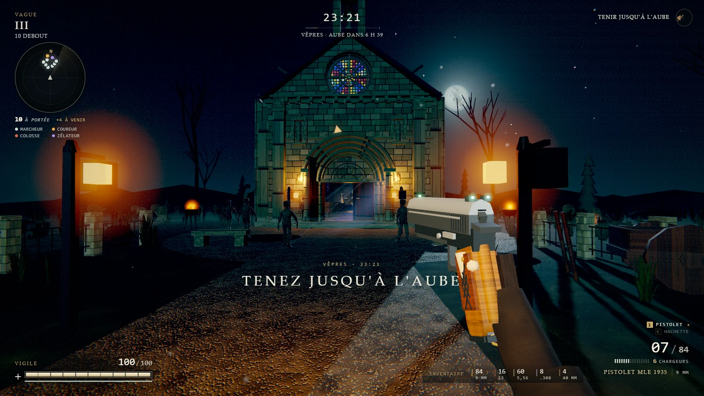
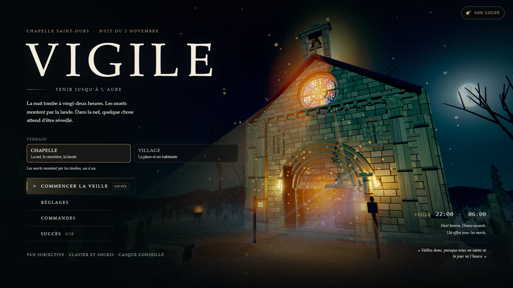
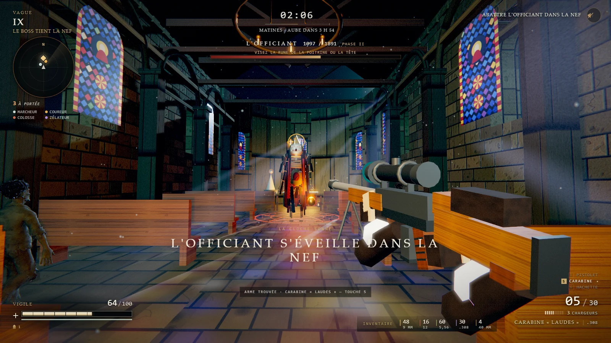
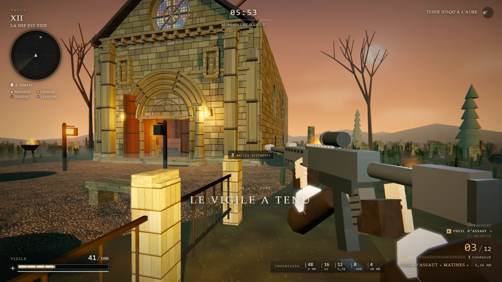
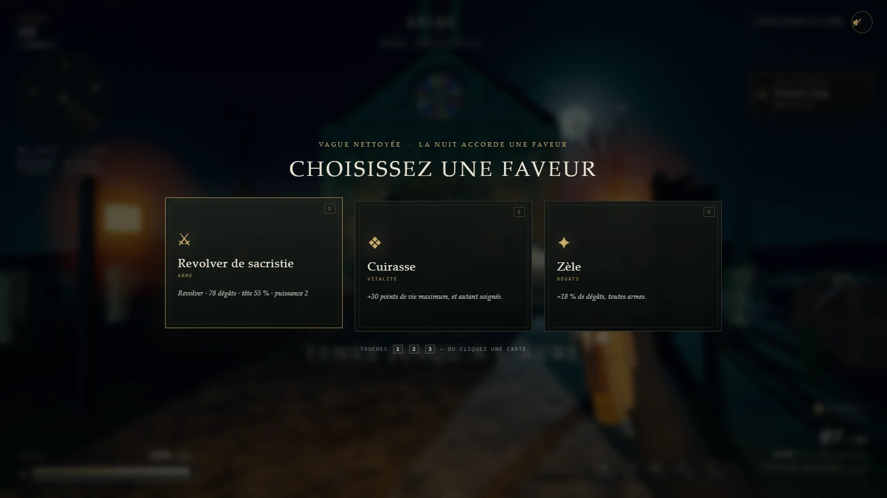
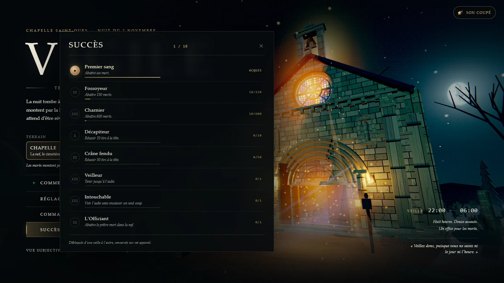
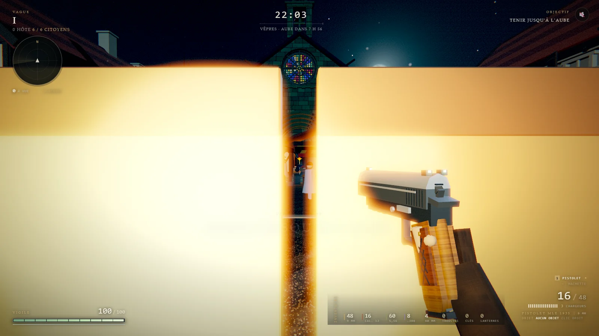

<div align="center">

# VIGILE

**Tenir jusqu'à l'aube.**
Shooter de survie en vue subjective, dans le navigateur — une chapelle romane, huit heures de nuit,
douze assauts de morts, et L'Officiant qui attend dans la nef.

[](https://jfoissac.github.io/Vigile/)
[](#sous-le-capot)
[](https://threejs.org)
[](LICENSE)
[](#ce-quil-y-a-dans-la-nuit)



</div>

**Vigile** est un shooter de survie à l'ancienne : pas de régénération, pas de sauvegarde au milieu,
pas de tutoriel qui tient la main. La nuit tombe à 22 h, les morts montent par la lande et par les
tombes, et il faut tenir jusqu'à 06 h. Entre deux vagues, la nuit accorde une faveur : une arme, une
cuirasse, du zèle. Puis **L'Officiant** s'éveille dans la nef — et la cloche sonne.

Tout tourne dans le navigateur, **sans build, sans CDN, sans `npm install`** : Three.js est vendorisé,
le monde est généré au démarrage, les modèles de morts sont des GLB CC0 embarqués dans le dépôt.
Un simple serveur statique suffit.

---

## ▶ Jouer

| Où | Comment |
|---|---|
| **En ligne** | [jfoissac.github.io/Vigile](https://jfoissac.github.io/Vigile/) |
| **Windows** | double-clic sur **`Lancer-Vigile.bat`** (ouvre le navigateur) |
| **macOS / Linux** | `./lancer-vigile.sh` |
| **À la main** | `python server.py` → [127.0.0.1:8131](http://127.0.0.1:8131/) |

`server.py` est un serveur statique de 100 lignes qui envoie `Cache-Control: no-store` : un module
modifié est rechargé au prochain F5, sans purge de cache. Chrome, Edge ou Firefox récent avec WebGL2 ;
le jeu tourne aussi en `--headless=new` (c'est ainsi qu'il est testé).

Le son démarre coupé — `M` ou le bouton 🔊 pour l'activer. La musique du dépôt n'est pas incluse
(voir [Musique](#musique)) : le jeu tourne avec la bande-son synthétisée.

---

## Ce qu'il y a dans la nuit

- **Deux terrains.** La **chapelle** (la nef, le cimetière, la lande) et le **village** (la place et
  ses six habitants), avec leurs vagues et leur boss propres.
- **Douze assauts qui ne se ressemblent pas** : Les errants, La meute, L'ossuaire, La procession,
  La horde, **L'Officiant**, La traque, Le siège, L'office noir, La marée, Le chevalet, La dernière
  veille. Chaque plan fixe sa composition, sa taille (6 à 29 hôtes), sa cadence et ses multiplicateurs ;
  au-delà, la nuit s'acharne.
- **Huit armes, mais on ne les a pas toutes.** On commence avec le pistolet Mle 1935 et la hachette de
  garde ; le fusil à pompe Saint-Éloi, le PM « Vêpres », le fusil d'assaut « Matines », la carabine
  « Laudes » (lunette ×2,5), le revolver de sacristie et la machette se ramassent sur les morts, dans
  les caisses, ou sont proposés en carte de récompense. Chaque arme a ses dégâts, sa cadence, sa
  puissance et son **taux d'abattage à la tête** — un tir net tue sur place, quel que soit le nombre
  de PV restants.
- **Butin et caches.** Caisses et coffres s'ouvrent au passage, les tombes se brisent en deux balles,
  les munitions ne tombent que pour les calibres possédés, la clé de la sacristie est posée sur
  l'autel (et garantie sur le boss).
- **Trois faveurs par vague** : une arme, +30 PV, +18 % de dégâts… on choisit à la fin de chaque
  assaut (`1` `2` `3` ou clic).
- **18 succès** persistants sur l'appareil, un inventaire qui met la veille en pause, des réglages
  sauvegardés (sensibilité, FOV, qualité, volume, inversion verticale).
- **Un HUD complet en français** : minimap, horloge de la nuit, compte des hôtes à portée, santé,
  munitions par calibre, arme active, objectif courant.

---

## Commandes

| Touche | Action |
|---|---|
| **Z A S E** / flèches | marcher (Z avant, A gauche, S arrière, E droite) |
| Maj | sprint (endurance limitée) |
| Espace | sauter |
| Clic gauche | tirer (ou frapper, à la lame) |
| **Clic droit** | utiliser l'objet actif — ou viser à la lunette si l'objet actif est « aucun » |
| Molette / `1`…`8` | changer d'arme |
| R | recharger |
| **I** | inventaire (met la veille en pause) |
| H / L / G | trousse, lanterne, fiole |
| F | éteindre / rallumer la lanterne |
| `1` `2` `3` | choisir une faveur en fin de vague (Échap : refuser) |
| M | couper / rétablir le son |
| Échap | pause, réglages, objectifs |

---

## Captures

| Menu — choix du terrain | L'Officiant dans la nef |
|:---:|:---:|
|  |  |

| L'aube, au bout de la nuit | Les faveurs entre deux vagues |
|:---:|:---:|
|  |  |

| 18 succès à débloquer | Le village, ses habitants et ses lampes |
|:---:|:---:|
|  |  |

---

## Sous le capot

```
index.html          importmap → ./vendor/three.module.js, un seul <script type="module">
src/
  core/             boucle, entrées, audio (WebAudio), réglages, téléporteur de scène
  game/             vagues, armes, butin, succès, faveurs, boss, horloge de la nuit
  entities/         joueur, morts (GLB), armes en vue subjective, objets
  world/            chapelle, village, cimetière, lande, ciel, éclairage
  fx/               particules, sang, impacts, vignette et grain d'écran
  ui/               HUD, inventaire, pause, menu, succès
vendor/             three.js 0.186 + GLTFLoader + utilitaires (aucun CDN)
assets/             GLB CC0 (zombies, humains, village, armes) — voir assets/CREDITS.md
tools/              harnais de test CDP (Chrome headless) : verify, playtest, bosstest…
server.py           serveur statique local (no-store)
```

Choix assumés :
- **Aucun bundler.** Des modules ES natifs et une `importmap` : on édite un fichier, on recharge,
  c'est joué. Le dépôt se lit comme il s'exécute.
- **Tout est local.** Three.js et les GLB sont dans le dépôt ; le jeu démarre sans réseau.
- **Le monde est procédural** (chapelle, village, cimetière, ciel, lampes, textures), à l'exception
  des personnages et des armes, modélisés puis exportés en GLB.
- **Les tests passent par le vrai jeu.** `tools/*.mjs` pilotent Chrome en CDP : ils lancent une
  veille, jouent des vagues, vérifient le HUD, les collisions, le loot, les succès, et prennent les
  captures du dépôt.

### Vérifier en local

```bash
python server.py 8131          # dans un terminal
node tools/verify.mjs          # dans un autre (Chrome requis)
```

Les autres harnais : `playtest.mjs`, `bosstest.mjs`, `zombietest.mjs`, `weaponstest.mjs`,
`itemstest.mjs`, `featurestest.mjs`, `progresstest.mjs`, `uiaudit.mjs`, `contrast.mjs`.

---

## Musique

Cinq bandes (menu, nuit, combat, boss, aube) ont été utilisées pendant le développement ; elles sont
**volontairement absentes du dépôt** (droits des morceaux, et copies de travail personnelles). Sans
elles, le jeu tourne normalement : les bruitages et l'ambiance sont synthétisés en WebAudio.

---

## Crédits et licence

- **Code : MIT** — voir [LICENSE](LICENSE).
- **Modèles de morts** : Quaternius, **CC0 1.0** (voir [assets/CREDITS.md](assets/CREDITS.md)).
- **Three.js** : MIT.
- Les view-models d'armes, le décor et les effets sont générés par le code.

Le projet est né d'un prototype **Unreal Engine 5** (même chapelle, mêmes vagues, même horloge) qui a
servi de référence de gameplay ; cette version navigateur est une réécriture complète en JavaScript.
